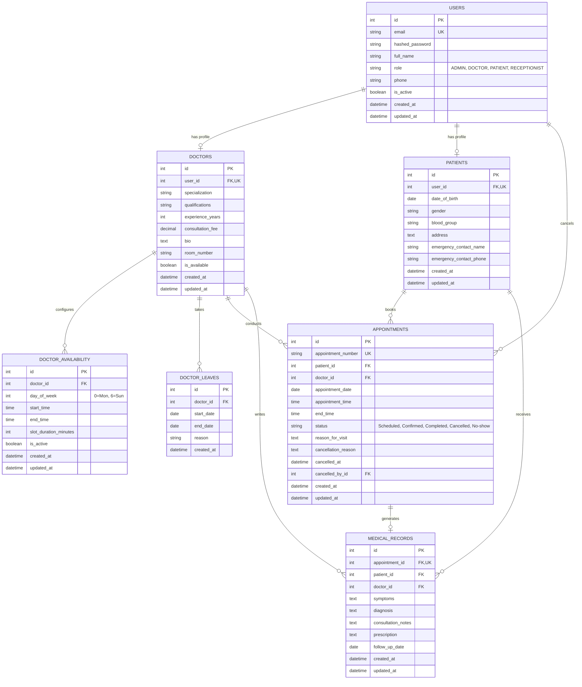

# Entity-Relationship (ER) Diagram & Database Architecture

## 1. Mermaid Entity-Relationship Diagram

## 2. Table Schemas and Constraints

### `users`
* `id`: `INTEGER PRIMARY KEY AUTOINCREMENT`
* `email`: `VARCHAR(255) NOT NULL UNIQUE INDEX`
* `hashed_password`: `VARCHAR(255) NOT NULL`
* `full_name`: `VARCHAR(255) NOT NULL`
* `role`: `VARCHAR(50) NOT NULL`
* `phone`: `VARCHAR(50) NULL`
* `is_active`: `BOOLEAN NOT NULL DEFAULT TRUE`

### `doctors`
* `id`: `INTEGER PRIMARY KEY AUTOINCREMENT`
* `user_id`: `INTEGER NOT NULL UNIQUE REFERENCES users(id) ON DELETE CASCADE`
* `specialization`: `VARCHAR(100) NOT NULL INDEX`
* `qualifications`: `VARCHAR(255) NOT NULL`
* `experience_years`: `INTEGER NOT NULL DEFAULT 0`
* `consultation_fee`: `NUMERIC(10, 2) NOT NULL DEFAULT 500.00`
* `bio`: `TEXT NULL`
* `room_number`: `VARCHAR(50) NULL`
* `is_available`: `BOOLEAN NOT NULL DEFAULT TRUE`

### `patients`
* `id`: `INTEGER PRIMARY KEY AUTOINCREMENT`
* `user_id`: `INTEGER NOT NULL UNIQUE REFERENCES users(id) ON DELETE CASCADE`
* `date_of_birth`: `DATE NOT NULL`
* `gender`: `VARCHAR(20) NOT NULL`
* `blood_group`: `VARCHAR(10) NULL`
* `address`: `TEXT NULL`
* `emergency_contact_name`: `VARCHAR(255) NULL`
* `emergency_contact_phone`: `VARCHAR(50) NULL`

### `doctor_availability`
* `id`: `INTEGER PRIMARY KEY AUTOINCREMENT`
* `doctor_id`: `INTEGER NOT NULL REFERENCES doctors(id) ON DELETE CASCADE`
* `day_of_week`: `INTEGER NOT NULL (0..6)`
* `start_time`: `TIME NOT NULL`
* `end_time`: `TIME NOT NULL`
* `slot_duration_minutes`: `INTEGER NOT NULL DEFAULT 30`
* `is_active`: `BOOLEAN NOT NULL DEFAULT TRUE`
* `CONSTRAINT uq_doctor_day UNIQUE (doctor_id, day_of_week)`

### `doctor_leaves`
* `id`: `INTEGER PRIMARY KEY AUTOINCREMENT`
* `doctor_id`: `INTEGER NOT NULL REFERENCES doctors(id) ON DELETE CASCADE`
* `start_date`: `DATE NOT NULL`
* `end_date`: `DATE NOT NULL`
* `reason`: `VARCHAR(255) NULL`

### `appointments`
* `id`: `INTEGER PRIMARY KEY AUTOINCREMENT`
* `appointment_number`: `VARCHAR(50) NOT NULL UNIQUE INDEX`
* `patient_id`: `INTEGER NOT NULL REFERENCES patients(id) ON DELETE CASCADE`
* `doctor_id`: `INTEGER NOT NULL REFERENCES doctors(id) ON DELETE CASCADE`
* `appointment_date`: `DATE NOT NULL INDEX`
* `appointment_time`: `TIME NOT NULL`
* `end_time`: `TIME NULL`
* `status`: `VARCHAR(30) NOT NULL DEFAULT 'Scheduled'`
* `reason_for_visit`: `TEXT NULL`
* `cancellation_reason`: `TEXT NULL`
* `cancelled_at`: `DATETIME NULL`
* `cancelled_by_id`: `INTEGER NULL REFERENCES users(id) ON DELETE SET NULL`
* `INDEX idx_doctor_date_time (doctor_id, appointment_date, appointment_time)`
* `INDEX idx_patient_date (patient_id, appointment_date)`

### `medical_records`
* `id`: `INTEGER PRIMARY KEY AUTOINCREMENT`
* `appointment_id`: `INTEGER NOT NULL UNIQUE REFERENCES appointments(id) ON DELETE CASCADE`
* `patient_id`: `INTEGER NOT NULL REFERENCES patients(id) ON DELETE CASCADE`
* `doctor_id`: `INTEGER NOT NULL REFERENCES doctors(id) ON DELETE CASCADE`
* `symptoms`: `TEXT NOT NULL`
* `diagnosis`: `TEXT NOT NULL`
* `consultation_notes`: `TEXT NULL`
* `prescription`: `TEXT NULL`
* `follow_up_date`: `DATE NULL`

